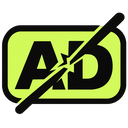

  

  # FuckAds

  **Less noise. Fewer detours. More of the web you actually came for.**

  Block distractions, get past supported link detours, and make your browser feel a little more like yours.

  
  
  

  [**Get FuckAds**](https://github.com/TheNinoDev/FuckAds./releases) · [Report a problem](https://github.com/TheNinoDev/FuckAds./issues)

---

## Your browser. Less clutter.

FuckAds brings the essentials together in one small extension:

- **Block distractions** — reduce ads, pop-ups, and tracking as you browse.
- **Skip the detour** — open supported links and let FuckAds work toward the destination.
- **Stay up to date** — filter lists refresh in the background and the extension lets you know when a new release is available.
- **Make it yours** — switch protection on or off and choose a browser identity when you need one.

Some websites may still show ads, require verification, or recognize your actual browser. Link bypass availability depends on the site.

## Get started

1. Download the latest **FuckAds.zip** from [Releases](https://github.com/TheNinoDev/FuckAds./releases) and extract it.
2. Open the extensions page in Chrome or Brave, turn on **Developer mode**, and choose **Load unpacked**.
3. Select the extracted FuckAds folder. Open the extension and turn on the ad blocker whenever you want it.

When a new version is available, the **Update** button downloads the new ZIP. Extract it over your existing FuckAds folder and reload the extension.

## Star history

If FuckAds makes your browsing better, give the project a star and follow the journey.

